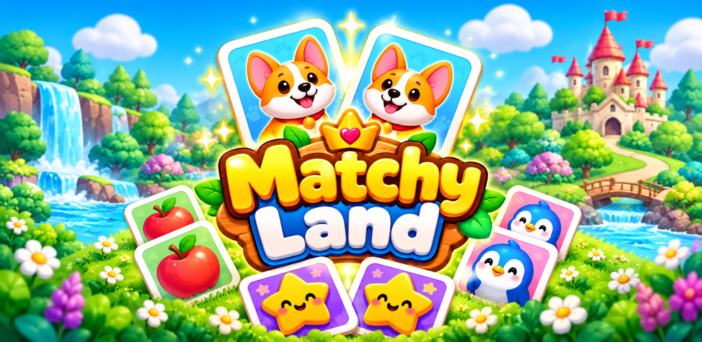
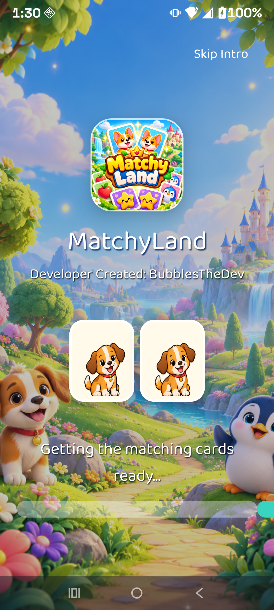
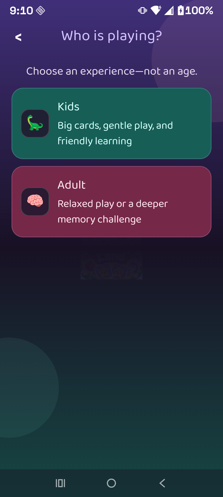
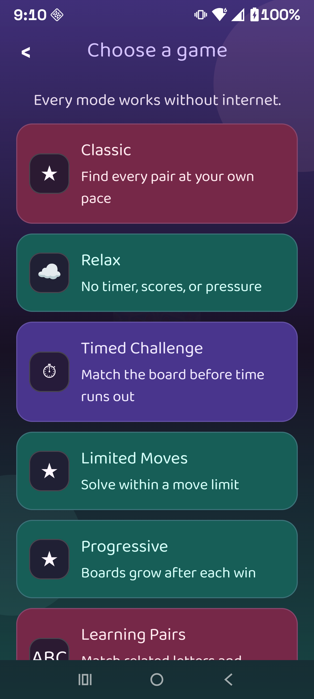
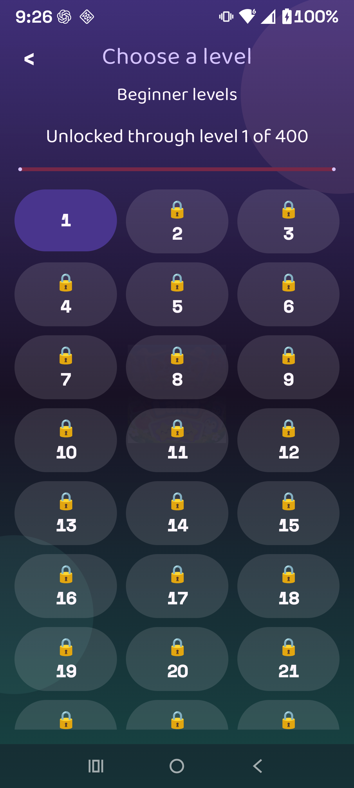
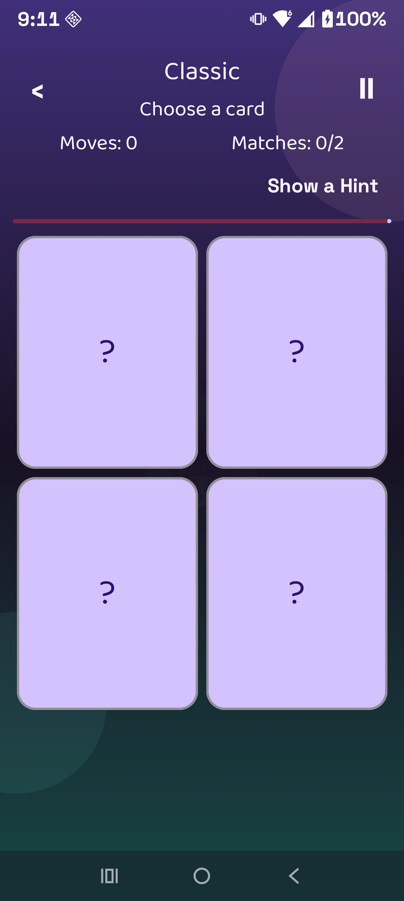
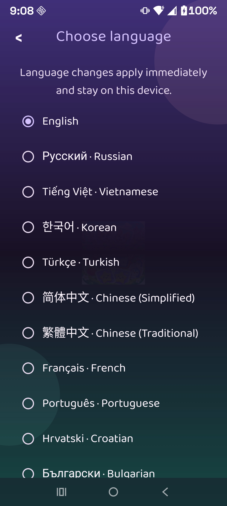

  

<h1 align="center">Welcome to MatchyLand</h1>

  <strong>A colorful, private, offline memory matching game for kids, adults, and every kind of mind.</strong>

  
  
  

  <a href="https://kernferm.github.io/MatchyLand-Android/"><strong>Visit the website</strong></a>
  ·
  <a href="https://kernferm.github.io/MatchyLand-Android/closed-beta.html">Closed-beta details</a>
  ·
  <a href="https://kernferm.github.io/MatchyLand-Android/privacy.html">Privacy</a>
  ·
  <a href="https://kernferm.github.io/MatchyLand-Android/support.html">Support</a>

## Closed beta coming soon

MatchyLand is being prepared for closed testing through Google Play. There is no public download yet, and this repository does not distribute an APK. Approved testers will install the game using the official Google Play testing link when invitations open.

## A matching adventure made for everyone

- 400 levels for every Kids and Adult difficulty
- Classic, Relax, Timed, Limited Moves, Progressive, Learning Pairs, Daily, and Custom modes
- Eight picture-and-word educational activities
- Thirty selectable in-app languages
- Sensory-friendly settings for motion, sound, vibration, timing, contrast, card size, and more
- Local profiles, achievements, statistics, hints, themes, and saved progress
- No account, advertising, analytics, tracking, or internet permission

## See MatchyLand

<table>
  <tr>
    <td align="center"> <strong>A playful welcome</strong></td>
    <td align="center"> <strong>Choose your experience</strong></td>
    <td align="center"> <strong>Make each game yours</strong></td>
  </tr>
  <tr>
    <td align="center"> <strong>Grow through 400 levels</strong></td>
    <td align="center"> <strong>Focused matching play</strong></td>
    <td align="center"> <strong>Thirty languages</strong></td>
  </tr>
</table>

## Private by design

MatchyLand works entirely offline. Optional nicknames, settings, progress, achievements, and game history remain in the app's private local storage on the device. Android cloud backup and device-transfer backup are disabled.

Read the full [MatchyLand Privacy Policy](https://kernferm.github.io/MatchyLand-Android/privacy.html).

---

  <strong>Developed &amp; Created By: Jeff | BubblesTheDev</strong> 
  MatchyLand 0.2.5 · Build 70 · Android 8.0+

> This repository contains the public MatchyLand website, policy pages, artwork, and screenshots only. It contains no Android application source, APK, AAB, signing material, credentials, or private Play Console data.
